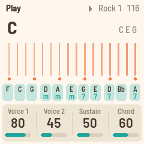
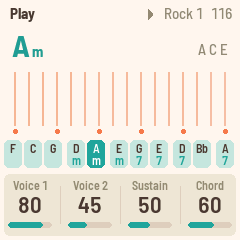
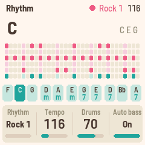

# Jambox FM-1

Jambox FM-1 is firmware for the M-VAVE FM-1, inspired by and forked from
[FoMni-1](https://github.com/charlesvestal/fm1-fomni).

Jambox turns the M-VAVE FM-1 into a chord harp inspired by the Suzuki Omnichord. The 16 white
keys are the strum plate: run a finger across them and they ring out the chord. The 11 black keys
are the chord buttons. Behind them sit an organ-like chord with its bass, and the OM-84's ten
rhythms and a reggae one, which can play the bass and chord in time (auto bass sync).

It is meant to be simple: one screen, four knobs a page, no patterns to program.

[](https://www.youtube.com/watch?v=pahaM6nzucE)

  

- **Try it in your browser** (no FM-1 needed): <https://raydnoper.github.io/fm1-fomnium/emu/>
- **Install it** (Chrome or Edge, with the FM-1 plugged in): <https://raydnoper.github.io/fm1-fomnium/install/>
- **Download the firmware file**: from the [site](https://raydnoper.github.io/fm1-fomnium/)

Installing is at your own risk, though it's hard to get stuck: the web installer can put M-VAVE's
firmware back, and an FM-1 that keeps crashing starts in a safe mode.

## Playing

| | |
|---|---|
| White keys | The strum plate. Each key plucks one string of the chord. As on the Omnichord, each group of three keys is root, third and fifth, folded into an F#–F window, five groups up, with a root on top. Strings on the Setup page changes this: **Linear** plays the chord's tones straight up, without the folding; **Fixed** makes each white key play its own note, F3 to G5 in C major, moved by Transpose and Octave; **Relative** lays out the scale of the chord that is playing, up from its root. |
| Black keys | Chord buttons (F C G, Dm Am, Em G7 E7, D7 Bb, A7 in the first chord set). Hold **ENV** for the minor, **LFO** for the 7th, both for the m7, the Omnichord's three rows. |
| PLAY | The rhythm, on and off. |
| REC | The chord sequence: on, and its page (see below). REC again on that page switches it off. Hold REC and press one of the first eight chord buttons to pick its track. On that page OCT− and OCT+ give the steps melodies. |
| ARP | CHORD HOLD: the chord keeps playing after you let go (press the same button again to stop it). |
| OCT− / OCT+ | Move the strum plate an octave. |
| SELECT | Tempo. |
| ALGORITHM | Rhythm: the eleven it comes with, then your own (made in the editor, see below). |
| PRESETS | Chord set, 1 to 8: what the black keys play. As they come, the sets are the same buttons in C, G, D, A, E, F, Bb and Eb. |
| KNOB 1–4 | The four values on the screen (see the pages below). |
| SAVE | Saves. Jambox also saves by itself a few seconds after a change, once it's quiet. |

### The pages

Each page puts four values on KNOB 1–4. EDIT steps through the pages.

- **HOME: Play.** Voice 1, Voice 2, Sustain, Chord level. Press HOME again for **Melody**: a tune made up as it plays, over the chords, while the rhythm runs and a chord sounds (held, CHORD HOLD, or the sequence), on the strings' voice, one note at a time. Melody (Off, or its level), Density (from a few long notes to busy runs), Seed (1 to 99, each its own tune: the same seed over the same chords plays the same melody again, from PLAY), Repeat (how much it keeps to its opening figure rather than wandering). It is random within rules songwriters keep: the chord's tones on the strong beats and the scale's notes between them, mostly steps, a leap followed by a turn back, a figure heard again over the next chords, and four-bar phrases that end on the root or the third. You can strum along over it; with a DX7 sound, its note counts among the nine.
- **SEQ: Rhythm.** Rhythm, Tempo, Drums level, Auto bass (on: the bass and chord play in time with the rhythm).
- **FX: Sound.** Reverb (the strings' send), Space (the plate's size), Width, Chord rev (the chord and bass's send). The drums stay dry.
- **SEL: Chords.** Change the chord on any black key: press the key, then turn Root (KNOB 1) and Type (KNOB 2). The change goes into the chord set in use (PRESETS), so each set can hold a song's chords. KNOB 3 is Transpose (−6 to +6). KNOB 4, Invert, is how that button's chord lies: OM, as the Omnichord has it (its notes folded into one fixed octave, the root in the bass); Root, root position; 1st and 2nd, the inversions, with their bottom note in the bass too (C/E, C/G). Dots under a chord's name show it. (OCT− and OCT+ still move the strum plate's octave.)
- **GLO: Setup.** Strings (Triads: the white keys play the chord's tones, folded into one octave a group as on the Omnichord; Linear: the same tones straight up the keys, five octaves from two below the middle to two above, each key higher than the last; Fixed: their own notes, a scale; Relative: the scale of the chord that is playing), Shift (with Relative: the scale moved along the keys, −6 to +6 of its steps, for a melody that sits elsewhere than from the root up), Tune, MIDI out. Press GLO again for **Setup 2**: Lights (On: the key lights, and the unlit buttons glow dimly so they can be read; Keys: the key lights only; Off), Dark (the screen in dark colours), Harp and Chord (the voice of the strings and of the chord: the Omnichord's, or one of the sounds of a DX7 bank, once the editor has given the FM-1 one, see below). And once more for **Setup 3**: Sync start (the rhythm waits for your first chord) Bass (the bass against the chord: 50 as it comes, 0 none, 100 twice as loud), and, shown only, Load: how much of the time it has the FM-1 takes to make the sound.
- **REC: Sequence.** A chord sequence: eight tracks of up to 32 steps, each step a chord for a number of beats. The track in use plays round while the rhythm runs. Hold REC and press one of the first eight chord buttons for another track (a verse, a chorus): while one plays, the new one starts when that comes round. The page shows sixteen steps at a time, the half the cursor or the playing step is in. With the rhythm stopped, press chord buttons one after another (ENV and LFO work as ever): each writes a step and moves on. A step keeps how its button's chord lies (Invert, on the Chords page). KNOB 1 picks a step, KNOB 2 and 3 change its Root and Type, KNOB 4 its Beats, 1 to 16; turned down to End, the sequence ends before that step. PLAY then starts the rhythm and the sequence from its first chord. The rhythm and tempo can change as it plays, since the sequence counts beats (three to a bar in the Waltz; the Blues' four are the slow ones of its 12/8). A chord button pressed while it plays sounds until the sequence's next chord. The steps hold chords, not buttons, so changing a chord set leaves the sequence alone; but they are counted from the set's key, which is the root of its second button (C in the first set), so PRESETS plays the same sequence in G, D and so on, from its next chord. **Melodies on the steps:** on this page, OCT− gives the step at the cursor a melody made up for its chord and beats (press again for another), OCT+ copies the step's melody, or pastes the copied one into a step without one, and OCT+ held takes the step's melody away. A note on a step shows it has one. A track with melodies plays them, each the same every time round (until Density or Repeat on the Melody page changes, or the step's chord), and is silent on its other steps; a track with none has the Melody page's tune as ever. Its level is the Melody page's (OCT− switches the melody on if it was off). On this page OCT− and OCT+ do not move the strum plate's octave.

**Voice 1** is the Omnichord's shimmering harp, and **Voice 2** is its plain one. Mix them, and
set how long the strings ring with **Sustain**.

### MIDI

MIDI comes in over USB and the TRS jack (the FM-1's jack is an input), and goes out over USB.

- **In, channel 1:** notes pluck the nearest string.
- **In, channel 2:** play a chord on a keyboard and it becomes the chord, as if you'd pressed a black key.
- **In, clock:** the rhythm follows MIDI clock and start / stop; the screen shows EXT for the tempo.
- **Out** (on by default, Setup page): the strings on channel 1, the chord on 2, the bass on 3, the melody on 4,
  the drums on 10, and clock with start / stop when the rhythm runs on its own tempo.

### Firmware switcher

For the stage: a web page (`web/omni_switch.html`, `switch/` on the site) keeps several FM-1 firmware packages in the browser of a phone or laptop (Jambox FM-1's own, and any `.fwsc` you add, such as the stock firmware) and writes any of them to the FM-1 over USB with the installer's updater. Opened once on line, it works without a network and can be installed as an app. Do not switch in the middle of a set.

### Editor: chord sets, rhythms and FM sounds

A web page (`web/omni_editor.html`, on the site next to the installer) shows the eight chord sets and changes them on the FM-1 over USB, in Chrome or Edge; it saves and loads them as a file. Its second tab is for rhythms of your own: eight places beside the eleven rhythms Jambox FM-1 comes with, each up to 32 sixteenth-note steps of the five drums, the bass and the chord, drawn on a grid. A rhythm that comes with it can be copied to a place and changed there. A change plays at once, so the rhythm can be made by ear while it runs. ALGORITHM reaches your rhythms after Reggae, passing over the empty places. Its third tab gives the FM-1 a DX7 bank: a `.syx` file of 32 sounds, which are then voices for the strings (Harp) and for the chord (Chord) on Setup 2, after the Omnichord's own. They are played as a DX7 has them, six operators in its 32 algorithms with their envelopes, scaling, detune, feedback, pitch envelope and LFO (vibrato, tremolo); not its touch, and a note is not let go: a string dies away as Sustain has it, and the chord has its own envelope. With one of them no more than nine strings sound at once (the one plucked longest ago gives way), as many notes as the FM-1's own firmware plays. The bank stays on the FM-1 until another is loaded. It talks SysEx ([web/EDITOR_PROTOCOL.md](web/EDITOR_PROTOCOL.md)), and works with the browser emulator too.

## Building and testing

The toolchain is the same as X0X's (see [BUILDING.md](BUILDING.md)):

```
tests/run_tests.sh      # the instrument, the platform pieces, the app in a simulator
./build.sh              # build/omni.fwsc
python3 tools/fm1_install.py build/omni.fwsc     # install it over USB
```

`build/host/omni_host SCRIPT OUTDIR` runs the whole app on a computer from a script
(`tests/scenarios/*.omni`), with audio and screenshots coming out. `web/emu/build.sh` builds the
same code for the browser.

## Credits

Jambox FM-1 is inspired by and forked from [FoMni-1](https://github.com/charlesvestal/fm1-fomni),
and most of it is FoMni-1's. This fork adds a
reggae rhythm, chord sets, scales on the strum plate, a dark screen, a chord sequence, a melody generator, DX7 voices from a bank, an editor for chord sets, rhythms and those and
a firmware switcher. The DX7 voices follow msfa, the engine of
[Dexed](https://github.com/asb2m10/dexed).

The rhythms, waves, drum sounds and envelope shapes come from
[Chordian](https://github.com/Jan125/pb.chordian), Jan125's OM-84 emulator (CC0). The platform
(hardware layer, USB, update loader, storage, installer) is
[Felucca](https://github.com/hugelton/Felucca)'s by Leo Kuroshita (Hügelton Instruments), by way of
[X0X](https://github.com/charlesvestal/fm1-x0x). GPL-3.0-only; see [LICENSING.md](LICENSING.md).

Omnichord is a trademark of Suzuki. Jambox isn't affiliated with or endorsed by Suzuki, M-VAVE or
Hügelton Instruments.
